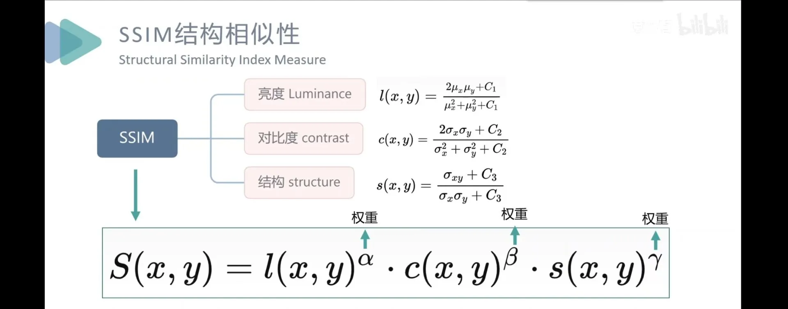

# Part1-任务二

## 问题回答

### 1. 目标函数

1.范数是数学上的概念，用以衡量向量的长度（而一个向量有多个长度，是因为由起点到终点的走法不同）。
具体来说，

- L1范数（曼哈顿距离）是沿坐标轴走的距离，二维坐标系中是菱形，是各分量的绝对值之和，数学表达式是L1 范数： $\lVert x \rVert_{1} = \sum_{i=1}^{n} \lvert x_{i} \rvert$


- L2范数（欧几里得长度）是常说的直线距离，二维坐标系中是圆形，是各分量的平方和开根号，数学表达式是 $\lVert x \rVert_{2} = \sqrt{\sum_{i=1}^{n} x_{i}^{2}}$
- 以向量（3，-4，5）为例，L1范数是是三个沿轴距离之和，即3+4+5=12.而L2范数就是坐标（3，-4，5）到原点的直线距离，即 $\sqrt{3^2+(-4)^2+5^2}=\sqrt{50}\approx7.07$

2. 将两张图片转成张量，然后展开成一维向量（L1/2范数是计算向量的长度的），然后按公式进行计算：

- L2 损失： $L_{MSE} = \frac{1}{NCHW} \sum_{n,c,h,w} (\hat Y_{n,c,h,w} - Y_{n,c,h,w})^2$


- L1 损失： $L_{L1} = \frac{1}{NCHW} \sum_{n,c,h,w} \lvert \hat Y_{n,c,h,w} - Y_{n,c,h,w} \rvert$
  N、C、H、W是batch大小、通道数、高度、宽度  
  $\hat Y_{n,c,h,w}     Y_{n,c,h,w}$分别是预测图象的相应位置的像素值和真实无雨图相应位置的像素值，最终得到损失值。
  > 注：在pytorch中：
  >
  > ```commandline
  > #L1损失
  > L1_loss = nn.L1Loss()
  > #L2损失
  > L2_loss = nn.MSELoss()
  > ```

> 与L1相比，L2的鲁棒性更弱，对异常值更加敏感（因为有平方）

### 2.评估指标



1. SSIM数值范围是【-1，1】，当两张图完全一样时为1；两张图片完全无关时取0；局部像素完全相反取负值（你亮我暗，很少见）
2. 亮度，对比度，结构
3. - PSNR的评估对象是独立的像素，和相邻像素是什么没有关系。
   - SSIM的评估范围是一个局部的像素块（高斯窗口）

## 疑惑

1. L1正则化会稀疏化参数，间接实现参数选择，而L2正则化不会让权重为0，只会缩小。造成这样的不同结果是不是也和L1，L2范数的菱形与圆形的图像有关？
