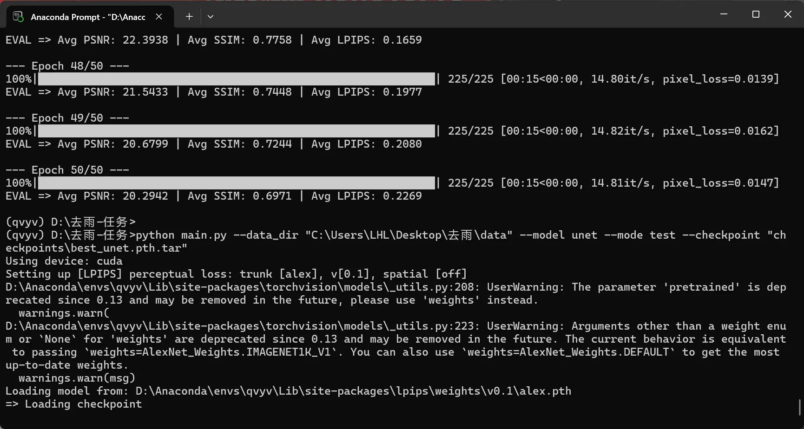

# Part2-第一部分-任务二

## 1. 基本问题

1. DerainNet.py代码如下：

```commandline
import torch
from torch import nn


class DerainNet(nn.Module):
    def __init__(self,c =64):
        super(DerainNet, self).__init__()
        self.all_conv_1 = nn.ModuleList()
        self.all_conv_2 = nn.ModuleList()
        self.all_conv_4 = nn.ModuleList()
        self.all_bn_1 = nn.ModuleList()
        self.all_bn_2 = nn.ModuleList()
        self.all_bn_4 = nn.ModuleList()
        self.conv1 = nn.Conv2d(in_channels=3,out_channels=c,kernel_size=3,padding=1)
        self.conv_out = nn.Conv2d(in_channels=3*c, out_channels=3, kernel_size=3, padding=1)
        self.pool = nn.MaxPool2d(kernel_size=2, stride=2)
        for _ in range(8):
            self.all_conv_1.append(nn.Conv2d(in_channels=c, out_channels=c, kernel_size=3, padding=1))
        for _ in range(8):
            self.all_conv_2.append(nn.Conv2d(in_channels=c,out_channels=c,kernel_size=3,padding=1))
        for _ in range(8):
            self.all_conv_4.append(nn.Conv2d(in_channels=c, out_channels=c, kernel_size=3, padding=1))
        for _ in range(8):
            self.all_bn_1.append(nn.BatchNorm2d(c))
        for _ in range(8):
            self.all_bn_2.append(nn.BatchNorm2d(c))
        for _ in range(8):
            self.all_bn_4.append(nn.BatchNorm2d(c))
        self.upsample = nn.Upsample(scale_factor=2, mode='nearest')
        self.relu = nn.ReLU(inplace = True)


    def forward(self,x):
        x_1 = self.conv1(x)
        x_2 = self.pool(x_1)
        x_4 = self.pool(x_2)
        y_1,y_2,y_4=x_1,x_2,x_4
        for i in range(8):
            y_1 = self.relu(self.all_conv_1[i](self.all_bn_1[i](y_1)))
        y_1 = x_1 +y_1
        for i in range(8):
            y_2 = self.relu(self.all_conv_2[i](self.all_bn_2[i](y_2)))
        y_2 = x_2 + y_2
        for i in range(8):
            y_4 = self.relu(self.all_conv_4[i](self.all_bn_4[i](y_4)))
        y_4 = x_4 + y_4

        y_2_up = self.upsample(y_2)
        y_4_up = self.upsample(self.upsample(y_4))

        residual =torch.concat((y_1,y_2_up,y_4_up),dim = 1)
        residual_3 = self.conv_out(residual)
        out = x -residual_3
        return out
```

2. 结果如下：  
   
3. 思考：为什么 DerainNet 要先下采样后上采样？下采样、上采样是什么？什么是 Concat？

- DerainNet的下采样有几个目的：
  1. 缩小图片的尺寸，以便于识别较长的雨丝，也就相当于扩大感受野
  2. 模糊图片中的噪音，减小误识别的可能性
  3. 多种尺寸会有不同的模糊度和不同层面的雨丝特征，利于对雨层的提取
  4. 下采样的固定作用：减少显存和算力负担，速度更快
- 上采样的目的：将缩小的图片重新放大到输入图片大小，保持图片的大小和分辨率（也只有这样，三张不同处理的图片才能叠加在一起）（上采样会很糊，所以必须有没有缩小的分支确保真实细节 ）
- 下采样：通过卷积或池化，将图片尺寸缩小
- 上采样：通过各种方式将图片放大（补全缺少的像素）（常用的方式有复制相邻像素的值，用以扩大图片分辨率，但这种方法锯齿化严重）
- Concat是torch中的一个函数（用torch.而不是nn.）在指定维度上拼接多个张量（），与torch.cat()等效，DerainNet的Concat是将图片沿通道方向并列摆放（通道数由c变成3c）（注意不是相加），然后交给卷积去融合三张图。

## 其他学习笔记

### 思想方面

1. 在Resnet的基础上增加三种不同的图片尺寸（通过Maxpooling），再在最后进行上采样，这样可以扩大感受野，识别到更长的雨丝。       
2. 在最后要将三种经过不同下采样的特征图的训练结果加权求和，进行线性的映射，不是简单的像素值叠加，而是并在一起之后交给卷积层再一次学习，压缩通道数。                                
3. 每一个卷积层都会提取出整个图像的部分特征（但各个特征图之间高度冗余），最后通过3x3卷积加权求和（卷积通道数的变化其实就是加权求和实现的）                                              
4. 在图片尺寸（分辨率）要扩大，就会产生大量没有像素值的区域，上采样会采用不同的方式将空白补全，比如用最邻近的像素值补，或使用周围像素的加权平均补等等                    
5. 一定要保留1:1的图进行训练，这样才能不丢失细节和分辨率。                     

#### 代码方面

1.为1:1的图创造8个不同的卷积层，放入nn.ModuleList()的对象中，不能创造一个用8次（这样用的是同一个权重，没有意义）

```commandline
for _ in range(8):
            self.all_conv_1.append(nn.Conv2d(in_channels=c, out_channels=c, kernel_size=3, padding=1))
```

2.

```commandline
for i in range(8):
  y_1 = self.relu(self.all_conv_1[i](self.all_bn_1[i](y_1)))
y_1 = x_1 +y_1
```

- 其中y_1 = x_1 +y_1就是用最初的特征图做保底，是Resnet的核心之一，注意这里的y_1,x_1都是特征图，不是原图也不是雨层图。         
3.  ` out = x -residual_3`最后一定不要忘了用原图减去雨图
