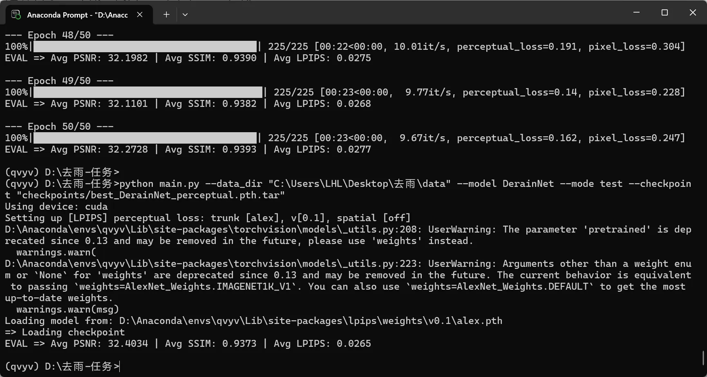
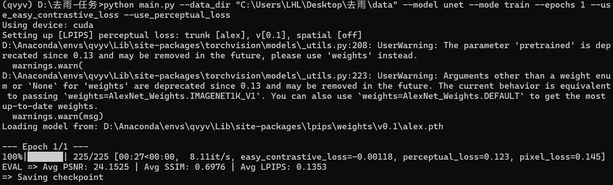

# Part2-第二部分

## 任务

1. 虽然仅仅是多使用了一个预训练模型，但恰恰是这个预训练模型，让本来用来算损失的对象从孤立的像素变成了一个个特征图，这样L1范数就衡量的是对应特征图之间的差距，而特征图是结合了一片区域的像素信息，所以LPIPS能更好地衡量感知差异
2. 用训练好的网络，可以提供大量的浅层特征，能更快地将我们给他的图像的特征提取出来，不用准备大量的数据和时间。
3. perceptual_loss.py代码如下：

```commandline
import torch
import torch.nn as nn
from torchvision.models import vgg19, VGG19_Weights


class PerceptualLoss(nn.Module):
    def __init__(self):
        super(PerceptualLoss, self).__init__()
        self.device = "cuda" if torch.cuda.is_available() else "cpu"
        self.vgg_pretrained = vgg19(weights=VGG19_Weights.IMAGENET1K_V1).features.to(self.device)
        self.vgg_pretrained.eval()
        self.vgg_pretrained.requires_grad_(False)
        self.net = nn.Sequential(*[self.vgg_pretrained[i] for i in range(35)])

        self.register_buffer("mean", torch.tensor([0.485, 0.456, 0.406]).view(1, 3, 1, 1))
        self.register_buffer("std", torch.tensor([0.229, 0.224, 0.225]).view(1, 3, 1, 1))

        self.loss_fn = nn.L1Loss()
        self.to(self.device).eval()
        self.ada = nn.AdaptiveAvgPool2d((None, 1))

    def forward(self, generated, ground_truth):
        generated_feature = self.net((generated - self.mean) / self.std)  
        truth_feature = self.net((ground_truth - self.mean) / self.std)
        generated_feature_1 = self.ada(generated_feature)
        truth_feature_1 = self.ada(truth_feature)
        loss= self.loss_fn(generated_feature_1, truth_feature_1)
        return loss
```

训练与测试结果如下：



## 向量

1. 向量就是一个有序的数组（也可以是一个有向箭头，起点为原点时通常可以表示成一个点），且是只有一维的张量。维度是长、宽、高、时间等衡量的参数，在向量中体现为分量数目，如[2,3,4,5]是四维的。（看到一个有趣的广义维度解释：维度是事物“有联系”的抽象概念的数量，也就是影响这个概念存在的多个方面，那招新题何尝不是我的一个维度呢（已疯））
2. 内积 （算gram矩阵的方法）

- 代数定义（坐标形式） $\langle \mathbf{x}, \mathbf{y} \rangle = \sum_{i=1}^{n} x_i y_i = x_1 y_1 + x_2 y_2 + \cdots + x_n y_n$


- 几何定义（长度与夹角形式） $\langle \mathbf{x}, \mathbf{y} \rangle = \lVert \mathbf{x} \rVert · \lVert \mathbf{y} \rVert \cos\theta$


- 其中 $\theta$ 是两个向量的夹角。
- 内积可以计算线性代数中的角度，从而关系到投影，位置关系，以及矩阵乘法的几何意义（3blue1brown 的视频里讲的网格图随基向量的角度变化）

3. 知道内积可以知道向量之间的大小+方向的相似性，但如果要判别单独的方向相似性，就要用到余弦相似度，把内积中的长度除掉。公式如下： $\mathrm{cos\_sim}(\mathbf{x}, \mathbf{y}) = \frac{\langle \mathbf{x}, \mathbf{y} \rangle} {\lVert \mathbf{x} \rVert \, \lVert \mathbf{y} \rVert} = \cos\theta \in [-1,\, 1]$

## 改造损失函数

> ### 疑惑：
>
> 对介绍中的这句话我有些疑惑：“通常我们会把向量归一化为单位向量，此时它们的长度相同，差别只在方向上。方向越接近，余弦相似度越大，也就是说这两个房子在特征上更相似。”
> 如果A房子面积100，卧室数2；B房子面积400，卧室数8：他们的向量在特征空间里应该是同一个方向，但预测值不同。这个时候难道还可以归一化来说明，这两个房子特征很相似吗？我觉得是不是归一后的余弦相似度比较可以代表一部分的特征相似，即在特征数值相似时，余弦相似度越大，也就是说这两个房子在特征上更相似。但特征数值相差较大时，余弦相似度越大，不能说这两个房子在特征上更相似。

### 任务

1. AdaptiveAvgPool2d：

- 根据指定的输出尺寸对输入特征图进行平均池化处理。与普通的池化层不同，自适应平均池化层不需要固定的窗口大小，而是根据输入的特征图大小动态地调整池化窗口，以确保输出的特征图始终具有预设的尺寸。
- 接受一个参数`output_size`，若是元组`(H, W)`，表示期望的输出高度和宽度，若是整数H，默认输出特征图是正方形，即H=W。

2. easy contrastive loss.py代码如下：

```commandline
import torch
import torch.nn as nn
from torchvision.models import vgg19, VGG19_Weights


class Easy_contrastive_loss(nn.Module):
    def __init__(self):
        super(Easy_contrastive_loss, self).__init__()
        self.device = "cuda" if torch.cuda.is_available() else "cpu"
        self.vgg_pretrained = vgg19(weights=VGG19_Weights.IMAGENET1K_V1).features.to(self.device)
        self.vgg_pretrained.eval()
        self.vgg_pretrained.requires_grad_(False)
        self.net = nn.Sequential(*[self.vgg_pretrained[i] for i in range(35)])

        self.register_buffer("mean", torch.tensor([0.485, 0.456, 0.406]).view(1, 3, 1, 1))
        self.register_buffer("std", torch.tensor([0.229, 0.224, 0.225]).view(1, 3, 1, 1))

        self.pool = nn.AdaptiveAvgPool2d((1, 1))
        self.to(self.device).eval()

    def forward(self, generated, ground_truth,raw):
        generated_feature = self.net((generated - self.mean) / self.std)  
        truth_feature = self.net((ground_truth - self.mean) / self.std)
        raw_feature = self.net((raw - self.mean) / self.std)
        raw_feature = self.pool(raw_feature).flatten(1)
        generated_feature = self.pool(generated_feature).flatten(1)
        truth_feature = self.pool(truth_feature).flatten(1)
        similarity_g_t = torch.cosine_similarity(generated_feature, truth_feature, dim=1)
        similarity_g_r = torch.cosine_similarity(generated_feature, raw_feature, dim=1)
        similarity_g_t_neg = -similarity_g_t
        return (similarity_g_t_neg + similarity_g_r).mean()
```

## 学习笔记

1. 可通过下面这种代码验证模块是否正确:

```commandline
cd D:\去雨-任务
python -c "import torch;from losses.perceptual_loss import PerceptualLoss;f=PerceptualLoss();a=torch.rand(2,3,128,128);print(float(f(a,a)))"
python -c "import torch;from losses.easy_contrastive_loss import Easy_contrastive_loss;f=Easy_contrastive_loss();a=torch.rand(2,3,128,128);print(float(f(a,a,a)))"
```

也可只训练一轮来验证代码写没写对：  

